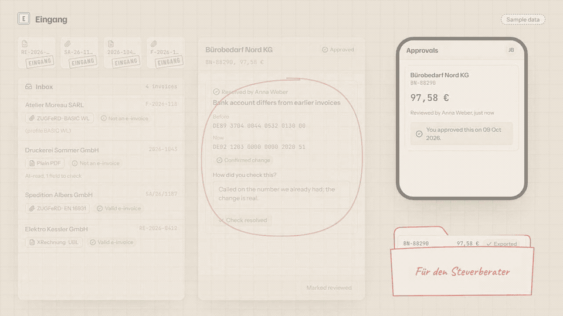
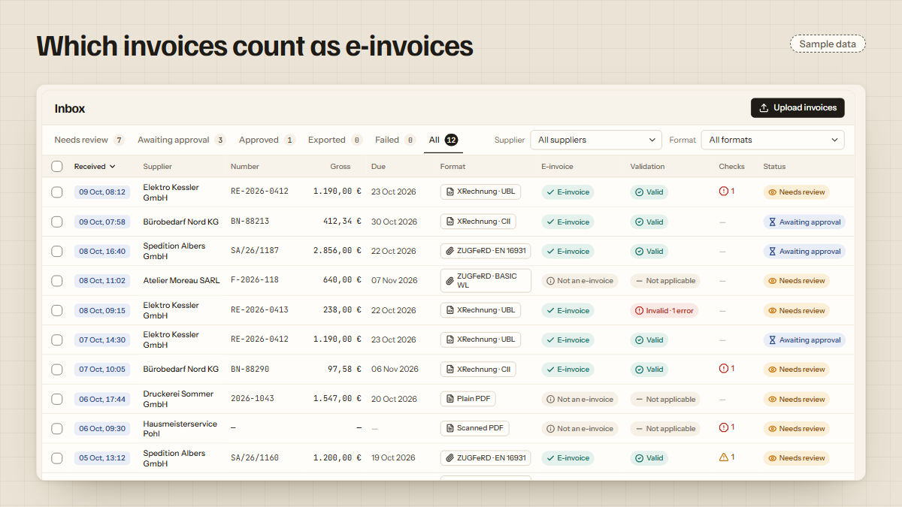
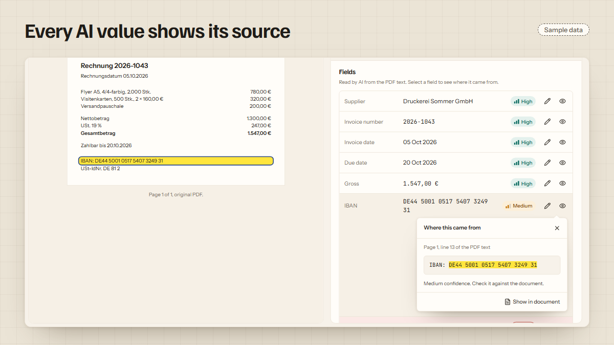
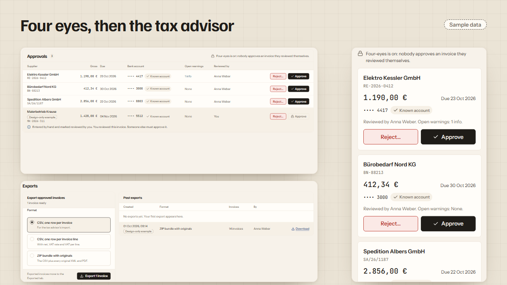
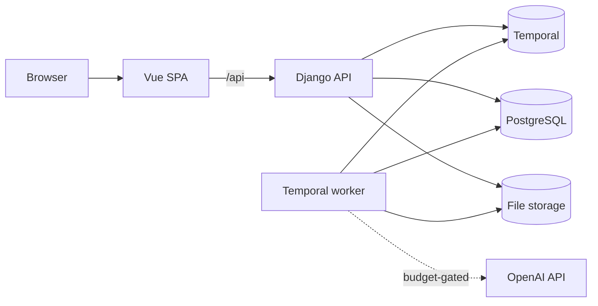

# Eingang: XRechnung and ZUGFeRD e-invoice validation and an inbox for supplier invoices

[](https://github.com/alihdrndm/eingang/actions/workflows/ci.yml)

**Eingang** is an open-source inbox for supplier invoices (_Eingangsrechnungen_) built for small German businesses. It checks whether each invoice is a valid **E-Rechnung**, validating **XRechnung** and **ZUGFeRD / Factur-X** files against the official **KoSIT** rules for **EN 16931**. It reads the data out of plain PDFs with an AI model and shows where every value came from. It also catches duplicate invoices and changed bank details, routes each invoice through four-eyes approval, and exports it for the tax advisor.

**Live demo: [eingang.vercel.app](https://eingang.vercel.app).** Choose **Open the sandbox** to get a private inbox with twelve sample invoices, which is deleted after 24 hours. AI extraction of new uploads is switched off in the demo. The demo runs on paid hosting and may be paused; the images below show it.

<p align="center">
  
</p>

**Watch the 70-second demo:** open the sandbox, upload an invoice, see where a value came from, read a validation error in plain English, check a new bank account, then approve and export.

https://github.com/user-attachments/assets/91caa19c-48a0-4c4d-b29a-d2f2c9f47cc4

<table>
  <tr>
    <td width="50%"></td>
    <td width="50%"></td>
  </tr>
  <tr>
    <td><b>Which invoices count as e-invoices.</b> Format, profile and validation result for every file.</td>
    <td><b>Every AI-read value shows its source.</b> Confidence plus the line of PDF text it came from.</td>
  </tr>
  <tr>
    <td width="50%"></td>
    <td width="50%"></td>
  </tr>
  <tr>
    <td><b>Duplicates and new bank accounts, caught.</b> Sixteen business checks run on every invoice.</td>
    <td><b>Four eyes, then the tax advisor.</b> Approval by a second person, then a CSV/ZIP export.</td>
  </tr>
</table>

## Contents

- [Why German businesses need to check e-invoices now](#why-german-businesses-need-to-check-e-invoices-now)
- [What Eingang does](#what-eingang-does)
- [Which invoice formats are supported](#which-invoice-formats-are-supported)
- [How an invoice moves through Eingang](#how-an-invoice-moves-through-eingang)
- [How accurate is it](#how-accurate-is-it)
- [Architecture](#architecture)
- [Run it locally](#run-it-locally)
- [Tests and quality](#tests-and-quality)
- [Security and privacy](#security-and-privacy)
- [Costs](#costs)
- [Data and licences](#data-and-licences)
- [Roadmap](#roadmap)

## Why German businesses need to check e-invoices now

Since 1 January 2025, every German business must be able to **receive** structured e-invoices that follow the European standard EN 16931. From 1 January 2027, businesses with more than €800,000 turnover may no longer **issue** paper or plain PDF invoices. From 1 January 2028 this applies to all domestic business-to-business invoices, except small invoices up to €250 ([European Commission, "eInvoicing in Germany"](https://ec.europa.eu/digital-building-blocks/sites/spaces/DIGITAL/pages/467108886/eInvoicing+in+Germany)).

An e-invoice is not a PDF that looks like an invoice. It is a machine-readable file: either **XRechnung**, which is pure XML in one of two syntaxes (UBL or UN/CEFACT CII), or **ZUGFeRD / Factur-X**, a PDF that carries the same kind of XML inside it. According to the BMF letter of 15 October 2024, the ZUGFeRD profiles MINIMUM and BASIC-WL do not count as e-invoices, and in such a hybrid file the XML is the authoritative part, not the visible PDF ([ELO summary of the BMF letter](https://www.elo.com/de-de/blog/e-rechnungspflicht-bmf-schreiben-und-faq.html)).

In a Bitkom survey of 1,103 German companies published in December 2024, only 45% could receive e-invoices ([vendor summary by Insiders Technologies](https://insiders-technologies.com/en/blog/e-invoicing-study-bitkom)). So for years a small company's _Rechnungseingang_ will be a mix of valid XRechnung files, ZUGFeRD PDFs of varying quality and ordinary PDFs. Someone has to check each one, type in the data, and notice when the same invoice arrives twice or a supplier's bank account suddenly changes, which is a common fraud pattern. Then the invoice needs approval and has to reach the tax advisor (_Steuerberater_).

Eingang is not tax or legal advice. It checks published technical rules (EN 16931, XRechnung) and simple bookkeeping consistency.

## What Eingang does

- **Detects the format** of each incoming file: XRechnung (UBL or CII), ZUGFeRD / Factur-X with its profile, plain PDF with a text layer, or scan.
- **Validates e-invoices** with the official XSD schemas and Schematron rules from the KoSIT XRechnung configuration (`v2026-01-31`), the same rule files the official KoSIT validator uses, and explains each failed rule in plain language.
- **Extracts the same fields from every invoice.** For XML it parses them directly. For a plain PDF, an AI model (`gpt-5-nano`) reads the PDF text and returns structured data, and each value keeps its evidence: the line it came from and a confidence level. A person checks anything uncertain.
- **Runs business checks C01–C16** on every invoice: duplicate invoice numbers, a changed or invalid IBAN, amounts that don't add up, an invalid VAT ID, an invoice addressed to someone else, a PDF whose text disagrees with its embedded XML, overdue invoices and more.
- **Routes invoices through review and four-eyes approval** (_Vier-Augen-Prinzip_: the person who reviewed an invoice cannot also approve it), with four roles: admin, accountant, approver and viewer.
- **Exports approved invoices** as German CSV files and a ZIP bundle with the originals, ready for the tax advisor.

## Which invoice formats are supported

| Format                                                  | What it is                                        | Counts as an e-invoice | How Eingang reads it                                              |
| ------------------------------------------------------- | ------------------------------------------------- | ---------------------- | ----------------------------------------------------------------- |
| XRechnung UBL                                           | XML, OASIS UBL syntax (invoices and credit notes) | Yes                    | Parses the XML, validates with XSD + Schematron                   |
| XRechnung CII                                           | XML, UN/CEFACT Cross Industry Invoice syntax      | Yes                    | Parses the XML, validates with XSD + Schematron                   |
| ZUGFeRD / Factur-X EN 16931, XRECHNUNG, BASIC, EXTENDED | PDF with the invoice XML embedded                 | Yes                    | Reads the embedded XML; compares it with the PDF text (check C09) |
| ZUGFeRD / Factur-X MINIMUM, BASIC WL                    | PDF with a reduced XML                            | No (BMF letter)        | Reads and validates the XML, flags "not an e-invoice"             |
| ZUGFeRD 1 (legacy)                                      | Older hybrid PDF with a pre-EN 16931 XML          | No                     | AI extraction from the PDF text                                   |
| Plain PDF with a text layer                             | An ordinary PDF invoice                           | No                     | AI extraction with evidence                                       |
| Scanned PDF                                             | An image with no text                             | No                     | Flagged for manual entry (OCR is on the roadmap)                  |

BASIC and EXTENDED, and XRechnung 1.x and 2.x, are checked against the EN 16931 rules only ([docs/ASSUMPTIONS.md](docs/ASSUMPTIONS.md)).

## How an invoice moves through Eingang

<p align="center">
  
</p>

Each uploaded file starts its own durable workflow. The workflow detects the format, validates it, extracts the fields and runs the checks, then waits, for days if needed, until a person reviews it and a different person approves it. Invoices can also arrive from an IMAP mailbox. If a step fails, the invoice says why and can be retried.

## How accurate is it

Full method, per-field numbers and limits: [docs/EVALS.md](docs/EVALS.md).

**Validation: the same verdicts as the official KoSIT validator.** On 176 test files, Eingang and KoSIT validator v1.6.0 gave the same valid/invalid verdict on **100%** of them, and the same set of failed rules on **100%**. This covers EN 16931 CII and XRechnung files; 64 files were excluded because KoSIT has no scenario for them or Eingang does not accept them.

**Extraction from PDF text: 65.4% fully right, against 21.2% for a regex baseline.** On 104 ZUGFeRD corpus invoices, the PDF's own embedded XML serves as the answer key. The "critical fields" are the invoice number, issue date, gross total and IBAN.

| System                       | All critical fields right | 95% confidence interval |                  Cost |
| ---------------------------- | ------------------------: | ----------------------- | --------------------: |
| Label-based regex baseline   |                     21.2% | 13.5–28.8%              |                    $0 |
| LLM extraction, `gpt-5-nano` |                 **65.4%** | 56.7–74.0%              | $0.000321 per invoice |

The 104 documents are only 33 distinct invoices in different versions, so the real intervals are wider than shown. This is why every AI-read value shows its evidence and confidence and still goes through review.

## Architecture

<p align="center">
  
</p>

The Vue 3 app talks only to its own origin, which forwards `/api` to the Django REST Framework API. The API stores each upload and starts one **Temporal** workflow per document. A separate worker does the heavy work: format detection, XSD and Schematron validation with SaxonC, PDF text extraction and the AI calls, which are capped by a hard budget. The API never imports that code. Details: [docs/ARCHITECTURE.md](docs/ARCHITECTURE.md).

<details>
<summary>The same as a Mermaid diagram</summary>



</details>

**Stack:** Python 3.13, Django 6.1, Django REST Framework 3.18, Temporal (Python SDK 1.34), SaxonC-HE 13, PostgreSQL 17, OpenAI API with structured outputs; Vue 3.5, TypeScript 5.9, Vite 8, Pinia, Vitest and Playwright. Deployed on Railway, Supabase and Vercel ([docs/DEPLOY.md](docs/DEPLOY.md)).

## Run it locally

Prerequisites: Docker with Compose v2, Node 24 with Corepack, and [uv](https://docs.astral.sh/uv/).

```sh
corepack enable
pnpm install
cd backend && uv sync --all-groups --all-extras && cp .env.example .env && cd ..
docker compose up -d --wait db temporal
cd backend && uv run python manage.py migrate && uv run poe ensure-schedules && cd ..
pnpm seed
pnpm dev
```

Open http://localhost:3110 and choose **Open the sandbox**, or sign in as `admin@example.invalid` with the password `eingang-dev` (the seed users; the password is `SEED_PASSWORD`). `pnpm dev` runs the API (http://localhost:8010), the worker and the web app; the Temporal UI is at http://localhost:8233. `pnpm verify` runs every check (the first run downloads the pinned test corpus, about 150 MB), and `pnpm test:e2e` runs the browser tests against the full Docker stack. The AI features stay off until `LLM_ENABLED=true` and an OpenAI key are set (see [docs/DEPLOY.md](docs/DEPLOY.md)).

## Tests and quality

- **1,521 backend tests** with **97%** line coverage, including every instance of the KoSIT XRechnung test suite and the ZUGFeRD corpus.
- **308 frontend component tests** (Vitest) and **5 end-to-end tests** (Playwright), including one that runs from opening the sandbox to the export.
- Ruff, mypy in strict mode and import-linter contracts on the backend; ESLint, Prettier and vue-tsc on the frontend. `pnpm verify` runs all of it, and CI runs it on every pull request and on every push to `main`.
- Every deviation from the original plan is written down in [docs/DECISIONS.md](docs/DECISIONS.md), and every statement not yet checked against a real system is in [docs/ASSUMPTIONS.md](docs/ASSUMPTIONS.md).

## Security and privacy

- Uploads are identified by their content, not their file name, and limited to 4 MB. XML parsing refuses any DOCTYPE and never resolves entities, which blocks XXE attacks, also for XML embedded in PDFs.
- Every query is scoped to the user's organisation, and a test tries every object endpoint from another organisation. Every unsafe request, sign-in included, needs a CSRF token.
- The AI model is called with storage switched off, the invoice text is fenced against prompt injection, and every call goes through a budget with daily, monthly and lifetime limits.
- Logs never contain invoice contents, names, IBANs, prompts or model output. Sandboxes are deleted after 24 hours.

Details, the personal data table and how to report a vulnerability: [SECURITY.md](SECURITY.md).

## Costs

Running all three backend services on Railway costs about **$5.61 per month** at measured idle use; the database, file storage and frontend run on free tiers. All AI calls for this project so far, including the full evaluation, cost **$0.034**. Measurements and prices: [docs/COSTS.md](docs/COSTS.md).

## Data and licences

- [ZUGFeRD corpus](https://github.com/ZUGFeRD/corpus) at commit `d891458e`: sample e-invoices used for parsing tests and the evaluation. Apache License 2.0. It is downloaded by `uv run poe fetch-corpus` into `data/corpus/` and never committed.
- KoSIT XRechnung validator configuration, visualisation and test suite (release `v2026-01-31`), vendored in `backend/vendor/`. Apache License 2.0; details in [NOTICE](NOTICE).
- Sandbox samples in `samples/`: twelve fictional invoices generated by `uv run poe build-samples`. They are this project's own work, MIT.
- Design export in `design/export/`: the owner's own work, MIT.
- Third-party artefacts are listed with their licences in [NOTICE](NOTICE).

## Verified vs assumed

Statements that were not verified against a real system are listed in [docs/ASSUMPTIONS.md](docs/ASSUMPTIONS.md).

## Roadmap

- DATEV EXTF "Buchungsstapel" export, following DATEV's official specification.
- OCR for scanned invoices, with a local engine so documents never leave the server.
- PDF/A-3 conformance checking with veraPDF.
- Profile-specific Factur-X Schematron for BASIC and EXTENDED.
- Peppol receiving through an access point.
- Email forwarding address per organisation instead of IMAP polling.
- Highlight the evidence for each extracted field directly on the rendered PDF.

## License

MIT. See [LICENSE](LICENSE).
